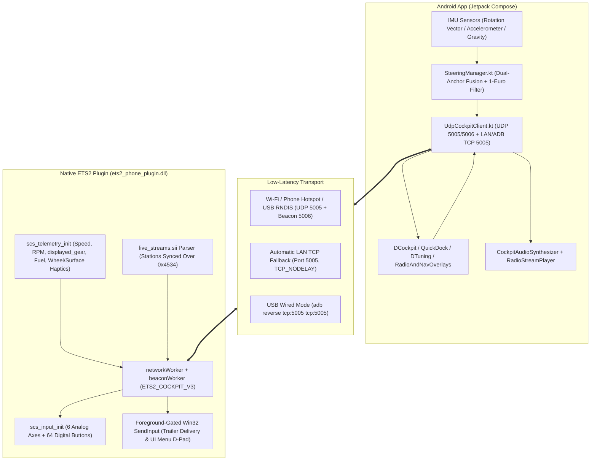

# ETS2 Phone Controller — Complete Technical Architecture & System Reference (V3)

> [!NOTE]
> This technical compendium documents the **V3 Native SCS SDK architecture**, inertial steering kinematics, `0x4532`/`0x4533`/`0x4534` UDP + TCP protocol, `controls.sii` auto-binding engine, GitHub Actions release pipeline, and diagnostics for **ETS2 Phone Controller**.

---

## Table of Contents
1. [Executive Summary & V3 System Architecture](#1-executive-summary--v3-system-architecture)
2. [Inertial Fusion & Zero-Deflection Steering Engine](#2-inertial-fusion--zero-deflection-steering-engine)
3. [Transmission (`displayed_gear`), Opticruise & Tachometer Physics](#3-transmission-displayed_gear-opticruise--tachometer-physics)
4. [Native SCS Input + Telemetry Plugin (`ets2_phone_plugin.dll`)](#4-native-scs-input--telemetry-plugin-ets2_phone_plugindll)
5. [ETS2 Profile Auto-Binding (`controls.sii`) & Steam Cloud Support](#5-ets2-profile-auto-binding-controlssii--steam-cloud-support)
6. [Binary Protocol Specification (`0x4532`, `0x4533`, `0x4534`)](#6-binary-protocol-specification-0x4532-0x4533-0x4534)
7. [Android Cockpit, Editable Quick Dock, Orientation Lock & Radio](#7-android-cockpit-editable-quick-dock-orientation-lock--radio)
8. [Turnkey Distribution: GitHub Actions Releases, Wi-Fi APK & Firewall](#8-turnkey-distribution-github-actions-releases-wi-fi-apk--firewall)
9. [Manual Build & Verification Commands](#9-manual-build--verification-commands)
10. [Troubleshooting Matrix & Diagnostics](#10-troubleshooting-matrix--diagnostics)

---

## 1. Executive Summary & V3 System Architecture

**ETS2 Phone Controller** turns an Android phone into a responsive heavy-truck steering wheel, analog pedal set (Gas, Brake, Clutch), button box (64 buttons + customizable Quick Dock), live cab radio browser, and telemetry dashboard for *Euro Truck Simulator 2*.

Unlike V1 virtual-gamepad wrappers (ViGEmBus), the **V3 system runs directly inside `eurotrucks2.exe`** as a native C++20 SCS SDK plugin ([`ets2_phone_plugin.cpp`](../pc/src/ets2_phone_plugin.cpp)), eliminating external kernel drivers while exposing exact game telemetry and 64 independent input channels.



### Core Specifications
| Spec | Value |
|:---|:---|
| **Control Uplink** | `29 bytes` @ 100 Hz (`0x4532` v3, 6 analog axes + 64-bit button mask + XOR) |
| **Telemetry & Haptics Downlink** | `47 bytes` @ 40 Hz (`0x4532` v3, speed, RPM, `displayed_gear`, temps, G-force, wheel/bump rumble + XOR) |
| **UI Navigation / Delivery** | `5 bytes` (`0x4533`, foreground-gated `SendInput` for `eurotrucks2.exe`) |
| **Cab Radio Sync** | `0x4534` framed packets parsed from ETS2 `live_streams.sii` |
| **Auto-Discovery** | `ETS2_COCKPIT_V3` UDP broadcast on port `5006` across active PC adapters |
| **Transport Modes** | UDP `5005`, automatic LAN TCP fallback on `5005`, or USB ADB `127.0.0.1:5005` |

---

## 2. Inertial Fusion & Zero-Deflection Steering Engine

Devices lacking a dedicated hardware MEMS rate gyroscope (e.g., Xiaomi phones using `virtual_gyroscope` synthesized from accelerometer differentiation) can suffer severe drift or $\pm 180^\circ$ wrap-around runaway under pitch tilt.

[`SteeringManager.kt`](../android/app/src/main/java/com/ets2controller/sensor/SteeringManager.kt) solves this cleanly using:
1. **Hemisphere Canonicalization + Relative Quaternion:** Computes $q_{\text{rel}} = q_{\text{base}}^{-1} \otimes q_{\text{curr}}$ (flipping sign if $q_b \cdot q_c < 0$) and extracts planar twist $\theta_{\text{twist}} = 2 \cdot \text{atan2}(r_z, r_w)$ wrapped to $[-180^\circ, +180^\circ]$.
2. **Absolute Gravity In-Plane Anchor:** Computes $\theta_{\text{grav}} = \text{atan2}(-g_y, \sqrt{g_x^2 + g_z^2}) - \theta_{\text{base,grav}}$ so horizontal rest always resolves strictly to $0.000^\circ$. Notice both standard and reverse landscape steering respond symmetrically because `-wz` and calibrated roll are used directly.
3. **Asymptotic Drift Bleed + Acoustic Decoupling:** Gently bleeds twist error toward gravity truth ($\delta_{\max} = 0.3^\circ/\text{s}$) only when quasi-static and while phone vibration feedback is idle.
4. **1-Euro Adaptive Low-Pass Filter ([`OneEuroFilter.kt`](../android/app/src/main/java/com/ets2controller/sensor/OneEuroFilter.kt)):** Suppresses micro-jitter when driving straight while cutting lag during sharp turns.
5. **Progressive / Speed-Sensitive Steering Curve & $C^2$ Quintic Deadband:** Smooth deadzone entry/exit with configurable wheel rotation (`540°–1080°`). Also supports **Touch Pad** and **Slide Strip** steering modes in the top bar.

---

## 3. Transmission (`displayed_gear`), Opticruise & Tachometer Physics

- **Coasting Fix (`displayed_gear`):** [`ets2_phone_plugin.cpp`](../pc/src/ets2_phone_plugin.cpp) subscribes to `SCS_TELEMETRY_TRUCK_CHANNEL_displayed_gear` (and `SCS_TELEMETRY_CONFIG_controls` `"shifter.type"`) rather than raw `engine_gear`, ensuring Simple Automatic transmissions hold the engaged dashboard gear (`D1..D12` / `C1..C2` / `R`) when lifting off the throttle instead of flashing `N`.
- **Crawler + Opticruise Mapping ([`DashboardGauges.kt`](../android/app/src/main/java/com/ets2controller/ui/DashboardGauges.kt)):** Distinguishes 14+ speed heavy haulers (`C1`, `C2`, road gears `1–12`) from 12-speed boxes and displays `A/D` vs `M` prefixes dynamically.
- **Diesel RPM Banding:** Maps RPM against green eco torque ($0–1500$ RPM), amber braking/power ($1500–2100$ RPM), and redline ($>2100$ RPM) without full-gradient squeezing bugs.

---

## 4. Native SCS Input + Telemetry Plugin (`ets2_phone_plugin.dll`)

Compiled as a 64-bit native Windows DLL deployed to `<ETS2>\bin\win_x64\plugins\ets2_phone_plugin.dll`:
- **Device Identity:** Registers SCS input device `ets2_phone_cockpit` (`"ETS2 Phone Cockpit Controller"`) with **6 float axes** (`steering`, `throttle`, `brake`, `clutch`, `look_x`, `look_y`) and **64 boolean button channels** (`horn`, `engine_toggle`, ..., `radio_play_pause` [bit 60], `radio_vol_up` [bit 61], `radio_vol_down` [bit 62], `radio_fav` [bit 63]).
- **Networking:**
  - Opens a non-blocking UDP socket bound to `0.0.0.0:5005` AND a framed non-blocking TCP socket bound to `0.0.0.0:5005` (`TCP_NODELAY`), serving both ADB loopback (`127.0.0.1`) and LAN TCP fallback seamlessly.
  - Broadcasts `ETS2_COCKPIT_V3` every second over each active non-loopback adapter on UDP port `5006`.
  - Enforces a **350 ms deadman failsafe** (`zeroAllControls()`) if phone packets stop arriving.
- **Foreground-Gated UI Navigation (`0x4533`):** `handleUiCommand()` verifies `GetForegroundWindow()` belongs to `eurotrucks2.exe` before injecting `SendInput` keystrokes (`Tab`, `Up/Down/Left/Right`, `Enter`, `Esc`) or calibrated 16:9 normalized cursor clicks for the 3 **TRAILER DELIVERY** options (`Where do you need it?`, `Let's play it safe`, `Skip`, and `Confirm`).
- **Live Radio Parsing (`live_streams.sii`):** Searches `Documents`, `OneDrive\Documents`, and `%OneDrive%` for `Euro Truck Simulator 2\live_streams.sii`, decodes `\xHH` escapes, and streams station rows (`0x4534`) to the app on connect or on `UI_CMD_RADIO_LIST_REQ`.

---

## 5. ETS2 Profile Auto-Binding (`controls.sii`) & Steam Cloud Support

[`pc/scripts/auto_bind_ets2.ps1`](../pc/scripts/auto_bind_ets2.ps1) eliminates manual 70-channel binding inside ETS2:
- **Multi-Location Discovery:** Scans `%USERPROFILE%\Documents`, `%USERPROFILE%\OneDrive\Documents`, localized `[Environment]::GetFolderPath('MyDocuments')`, AND **Steam Cloud profiles** under `<SteamPath>\userdata\*\227300\remote\`.
- **Clean Slot Assignment:** Detects or claims the `device joy` / `joy2` slot for `sdk.ets2_phone_cockpit`, writes axis `c_jzthrottle`/`c_jzbrake` (`1.000000`) and zeroed steering deadzones, strips stale `joy.b*` tokens when `joy` is assigned, avoids binding collisions on `wipersback`/`motorbrake`, creates `.bak` backups, and writes **UTF-8 without BOM** so ETS2 parses `SiiNunit` cleanly.
- **`-CheckOnly` Mode:** Used by `start.bat` to report accurate status across all profiles (returning `0` bound, `2` needs binding, or `3` no profile created yet).

---

## 6. Binary Protocol Specification (`0x4532`, `0x4533`, `0x4534`)

Defined identically in [`pc/src/protocol.h`](../pc/src/protocol.h) and [`UdpCockpitClient.kt`](../android/app/src/main/java/com/ets2controller/network/UdpCockpitClient.kt) (`#pragma pack(push, 1)` + `static_assert`).

### 6.1 PhoneControlPacket (`0x4532`, v3, `29 bytes`, Phone → PC @ 100 Hz)
| Offset | Field | Type | Description |
|:---|:---|:---|:---|
| `0..1` | `magic` | `uint16_t` | `0x4532` (`"E2"`) |
| `2` | `version` | `uint8_t` | `3` |
| `3` | `flags` | `uint8_t` | `bit 0`: Coach Smooth Mode, `bit 1`: Look Autocenter, `bit 2`: Ping |
| `4..5` | `sequenceId` | `uint16_t` | Rolling sequence counter |
| `6..7` | `clientTimestampMs` | `uint16_t` | Echoed by PC for RTT ping |
| `8..15` | `buttonMask` | `uint64_t` | Bits `0..63` representing 64 simultaneous buttons |
| `16..17` | `steering` | `int16_t` | `-32767 .. +32767` |
| `18..19` | `throttle` | `uint16_t` | `0 .. 65535` |
| `20..21` | `brake` | `uint16_t` | `0 .. 65535` |
| `22..23` | `clutch` | `uint16_t` | `0 .. 65535` |
| `24..25` | `lookX` | `int16_t` | `-32767 .. +32767` |
| `26..27` | `lookY` | `int16_t` | `-32767 .. +32767` |
| `28` | `checksum` | `uint8_t` | XOR of bytes `0..27` |

### 6.2 TruckTelemetryPacket (`0x4532`, v3, `47 bytes`, PC → Phone @ 40 Hz)
| Offset | Field | Type | Description |
|:---|:---|:---|:---|
| `0..1` | `magic` | `uint16_t` | `0x4532` |
| `2` | `version` | `uint8_t` | `3` |
| `3` | `safetyFlags` | `uint8_t` | Trailer connected, blind spots, collision, LKA, auto-shifter (`bit 5`), park lights |
| `4..7` | `speedKmh` | `float` | Road speed (km/h) |
| `8..11` | `engineRpm` | `float` | Engine RPM |
| `12..15` | `maxRpm` | `float` | Engine redline RPM |
| `16..19` | `airPressureBar` | `float` | Brake air pressure (bar) |
| `20` | `gear` | `int8_t` | Displayed gear (`<0` reverse, `0` neutral, `>0` forward) |
| `21` | `forwardGears` | `uint8_t` | Total forward gears |
| `22..28` | Percentages & levels | `uint8_t[7]` | `fuelPercent`, `adbluePercent`, `speedLimitKmh`, `cruiseSpeedKmh`, `truckDamagePct`, `retarderLevel`, `accDistanceLevel` |
| `29..30` | `lateralG100`, `longitudinalG100` | `int8_t[2]` | G-forces $\times 100$ |
| `31..32` | `rumbleLarge`, `rumbleSmall` | `uint8_t[2]` | Suspension bump & road-surface haptics (`0..255`) |
| `33..34` | `dashboardFlags` | `uint16_t` | Blinkers, hazard, park brake, engine, low air, cruise, retarder, eng brake, low/high beam, beacon, wipers, diff lock, lift axles |
| `35..36` | `routeDistanceKm` | `uint16_t` | Advisor distance remaining (km) |
| `37..38` | `routeTimeMin` | `uint16_t` | Advisor ETA (min) |
| `39..40` | `echoTimestampMs` | `uint16_t` | Echoed uplink timestamp |
| `41..42` | `oilTempC` | `int16_t` | Oil temperature (°C) |
| `43..44` | `waterTempC` | `int16_t` | Coolant temperature (°C) |
| `45` | `batteryVolts10` | `uint8_t` | Battery voltage $\times 10$ |
| `46` | `checksum` | `uint8_t` | XOR of bytes `0..45` |

### 6.3 UI & Radio Packets (`0x4533` & `0x4534`)
- **`UiCommandPacket` (`0x4533`, 5 bytes):** `[magic:2][cmd:1][arg:1][xor:1]`.
- **`RadioRowHeader` (`0x4534`, 11 bytes + payload + 1-byte XOR):** `[magic:2][index:2][totalCount:2][flags:1][bitrate:2][payloadLen:2]` + UTF-8 `"name\tgenre\tcountry\turl"`.

---

## 7. Android Cockpit, Editable Quick Dock, Orientation Lock & Radio

- **Orientation Lock ([`MainActivity.kt`](../android/app/src/main/java/com/ets2controller/MainActivity.kt), [`DTuning.kt`](../android/app/src/main/java/com/ets2controller/ui/DTuning.kt)):** Prevents unwanted 180° flips during heavy steering turns via **Tuning → Cockpit → SCREEN ORIENTATION** (`Lock L` default, `Lock R`, or `Auto`).
- **Editable Quick Dock & Pin-to-Dock ([`QuickDock.kt`](../android/app/src/main/java/com/ets2controller/ui/QuickDock.kt), [`DPanels.kt`](../android/app/src/main/java/com/ets2controller/ui/DPanels.kt), [`SettingsRepository.kt`](../android/app/src/main/java/com/ets2controller/config/SettingsRepository.kt)):**
  - Persistent 8-slot `quickDockBits` customized either inline via **Quick Dock → Edit** (`◀` / `▶` reorder + 2-column action picker + `Reset`) or via **More → Pin to Dock** (`#1–#8` slot badges + bottom bar).
  - Live telemetry highlights for active controls (`isControlActive`).
- **Cab Radio & Delivery Picker ([`RadioAndNavOverlays.kt`](../android/app/src/main/java/com/ets2controller/ui/RadioAndNavOverlays.kt), [`RadioStreamPlayer.kt`](../android/app/src/main/java/com/ets2controller/audio/RadioStreamPlayer.kt)):** Searchable ETS2 station browser supporting both in-game `ETS2 RADIO` volume/play/fav controls (without pausing ETS2) and direct `PHONE STREAM` HTTP playback.
- **Animations & Resilience:** `AnimatedVisibility` + `Animatable` drag-to-close on Quick Dock, `AnimatedContent` tab transitions, and `LocalReduceMotion` support.

---

## 8. Turnkey Distribution: GitHub Actions Releases, Wi-Fi APK & Firewall

- **CI/CD Workflow ([`.github/workflows/release.yml`](../.github/workflows/release.yml)):** On pushes to `main` or `v*` tags, builds `ets2_phone_plugin.dll` (MSVC `/MT` static CRT + `dumpbin /exports` check), runs `.\gradlew testDebugUnitTest assembleDebug`, and publishes `ets2_phone_plugin.dll`, `ets2-phone-controller.apk`, and `ETS2-Phone-Controller-Portable.zip` under GitHub Releases (`latest`).
- **Installer Launcher ([`start.bat`](../start.bat)):**
  - Uses [`find_ets2.ps1`](../pc/scripts/find_ets2.ps1) (override `pc/ets2_path.txt`, Steam VDF, Uninstall registry, all fixed drives) + option `[P]` for custom folders.
  - Auto-downloads `ets2_phone_plugin.dll` from GitHub Releases when no local C++ compiler is present.
  - Option `[B]` installs via ADB or starts [`serve_apk_wifi.ps1`](../pc/scripts/serve_apk_wifi.ps1) on port `8099` so phones download the APK directly in Chrome without USB debugging or Android Studio.
  - Option `[F]` creates `-Profile Any` firewall rules for UDP `5005/5006`, TCP `5005/8099`, and `eurotrucks2.exe` so **Public** Wi-Fi / Hotspots / USB RNDIS never block traffic.

---

## 9. Manual Build & Verification Commands

- **PC Plugin (MinGW `g++` static build):**
  ```powershell
  g++ -O2 -Wall -Wextra -shared -static -static-libgcc -static-libstdc++ -std=c++20 -DNDEBUG `
      -I"pc/src" -I"pc/include/scssdk" "pc/src/ets2_phone_plugin.cpp" `
      -o "pc/build/ets2_phone_plugin.dll" -lws2_32 -liphlpapi -luser32
  ```
- **PC Plugin (CMake + MSVC `/MT`):**
  ```powershell
  cmake -S pc -B pc/build-cmake -A x64 -DCMAKE_MSVC_RUNTIME_LIBRARY=MultiThreaded
  cmake --build pc/build-cmake --config Release
  ```
- **Android Unit Tests & APK Build:**
  ```powershell
  cd android
  .\gradlew.bat testDebugUnitTest assembleDebug
  ```
- **Android On-Device Instrumentation Tests:**
  ```powershell
  cd android
  .\gradlew.bat connectedDebugAndroidTest
  ```

---

## 10. Troubleshooting Matrix & Diagnostics

| Symptom | Cause | Fix |
|:---|:---|:---|
| **`Missing device sdk.ets2_phone_cockpit` in ETS2** | DLL missing or ETS2 hadn't consented to SDK yet | Copy `ets2_phone_plugin.dll` into `<ETS2>\bin\win_x64\plugins\`, launch ETS2, click **OK** on *"Request to use advanced SDK features"*, exit ETS2, then run `[A]` in `start.bat`. Verify via `[L]`. |
| **Plugin DLL missing (`No C++ compiler found`)** | GitHub clone without MSVC/`g++` | `start.bat` auto-downloads from GitHub Releases on launch or via `[C]`. |
| **Cannot install APK (No Android Studio / No USB ADB)** | Missing SDK or USB debugging disabled | Press `[B]` in `start.bat` to open the Wi-Fi download page (`http://<PC-IP>:8099/`) in your phone browser. |
| **Phone stuck on `NO PC`** | Public Wi-Fi firewall, VPN adapter, or AP isolation | Press `[F]` in `start.bat`, enter the non-VPN LAN IP manually (triggers automatic TCP `5005` fallback), or use **`USB 127.0.0.1`** / Phone Hotspot. |
| **Steering stuck or drifts mid-turn** | Uncalibrated baseline or `Auto` sensor flip | Lock orientation (`Lock L`/`Lock R` in **Tuning → Cockpit**) and hold **CENTER** at your normal driving angle. |
