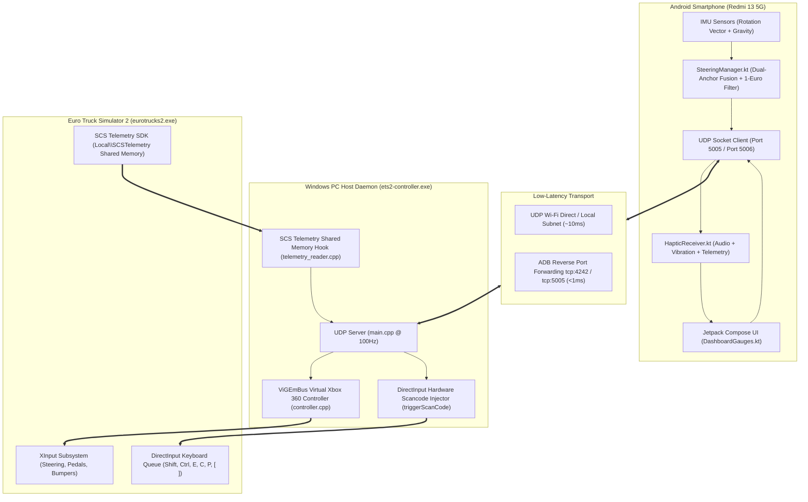
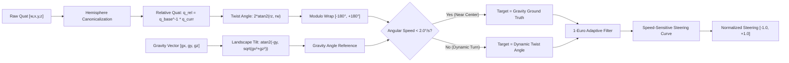

# ETS2 Phone Controller — Complete Technical Compendium & Master Research Documentation

> [!NOTE]
> This master document provides the exhaustive technical reference, kinematic sensor research, architectural blueprints, communication protocol specifications, and operational walkthroughs for the **ETS2 Phone Controller System**.

---

## Table of Contents
1. [Executive Summary & System Architecture](#1-executive-summary--system-architecture)
2. [Deep Kinematic Research: The Xiaomi Virtual Gyroscope Challenge](#2-deep-kinematic-research-the-xiaomi-virtual-gyroscope-challenge)
3. [Dual-Anchor Inertial Fusion & Zero-Deflection Steering Engine](#3-dual-anchor-inertial-fusion--zero-deflection-steering-engine)
4. [Transmission Engineering: Scania 12+2 Opticruise & Crawler Gears](#4-transmission-engineering-scania-122-opticruise--crawler-gears)
5. [Tachometer Physics: Authentic Diesel RPM Banding](#5-tachometer-physics-authentic-diesel-rpm-banding)
6. [Dual-Dispatch Input Pipeline: ViGEm Kernel Driver + DirectInput](#6-dual-dispatch-input-pipeline-vigem-kernel-driver--directinput)
7. [ETS2 Profile Configuration Engine (`controls.sii`) & The "Joy: missing" Bug](#7-ets2-profile-configuration-engine-controlssii--the-joy-missing-bug)
8. [Binary UDP Communication Protocol Specification](#8-binary-udp-communication-protocol-specification)
9. [End-to-End Build, Deployment & Verification Walkthrough](#9-end-to-end-build-deployment--verification-walkthrough)
10. [Comprehensive Troubleshooting Matrix & Diagnostics](#10-comprehensive-troubleshooting-matrix--diagnostics)

---

## 1. Executive Summary & System Architecture

The **ETS2 Phone Controller** transforms an Android smartphone into an ultra-low-latency, force-feedback-enabled heavy truck steering wheel and dashboard cockpit for *Euro Truck Simulator 2* (ETS2) and *American Truck Simulator* (ATS).



### Core Specifications
* **Control Input Rate:** 100 Hz (10 ms hardware interval, zero rendering hitching via dedicated `HandlerThread`).
* **Telemetry Streaming Rate:** 20 Hz (50 ms interval, streaming 32-byte binary datagrams).
* **Transport Protocol:** UDP with XOR checksum validation and RTT ping roundtrip tracking.
* **Driver Emulation:** Microsoft Xbox 360 controller via kernel IOCTL (`vigem_bus.sys`).
* **DirectInput Injection:** Hardware scan codes with $wVk = 0$ for compatibility with DirectX exclusive message pumps.

---

## 2. Deep Kinematic Research: The Xiaomi Virtual Gyroscope Challenge

### 2.1 Hardware Reality
Hardware analysis via Android `dumpsys sensorservice` revealed that the target device (**Xiaomi Redmi 13 5G**, hardware identifier `35fbb9da`) **lacks a dedicated physical MEMS rate-gyroscope IC** (such as an InvenSense MPU-6050 or Bosch BMI160). Instead, Android exposes:

```text
Sensor: virtual_gyroscope | Xiaomi | ver: 1 | type: android.sensor.gyroscope
Underlying Hardware: Bosch Sensortec BMA2x2 3-axis Accelerometer
```

The vendor HAL synthesizes angular rate vectors by differentiating linear acceleration vectors over time:
$$\vec{\omega}_{\text{synthetic}} = \frac{d\vec{a}}{dt} \times \vec{r}_{\text{lever}}$$

### 2.2 The Root Causes of Steering Runaway & Hysteresis
1. **Mathematical Singularity on Pitch Tilt:**
   In the legacy unwrapping algorithm:
   ```kotlin
   var delta = currentFrameAngle - prevRawAngle
   while (delta > 180.0f) delta -= 360.0f
   while (delta < -180.0f) delta += 360.0f
   continuousAngle += delta
   ```
   When the user held the phone in landscape with a natural forward tilt ($30^\circ - 45^\circ$ pitch), normal hand trembles caused the quaternion scalar component $r_w$ to periodically cross the zero threshold. The relative twist angle jumped from $+179^\circ$ to $-179^\circ$, triggering the modulo unwrapper to add $+360^\circ$ repeatedly.
   Consequently, `continuousAngle` pegged at $> +720^\circ$ (full right lock). When returning the phone to the physical horizontal center, the angle only dropped to $+675^\circ$, which was still hard-clamped at $+1.0$ (100% full right). **To the driver, the wheel appeared to keep turning in the same direction!**

2. **Sign Inversion in Gravity Bleed:**
   The legacy drift bleed formula calculated:
   $$\theta_{\text{bleed}} = \text{atan2}(-g_y, -g_x)$$
   When the phone was pitch-tilted, the sign of $-g_x$ flipped, inverting the correction vector and actively driving `driftOffset` away from center rather than toward it.

---

## 3. Dual-Anchor Inertial Fusion & Zero-Deflection Steering Engine

To permanently resolve the virtual gyroscope limitations without requiring hardware modification, the steering pipeline was redesigned in [`SteeringManager.kt`](file:///d:/Projects/ets2-phone-controller/android/app/src/main/java/com/ets2controller/sensor/SteeringManager.kt).

### 3.1 Mathematical Formulation



#### Step 1: Quaternion Relative Rotation & Hemisphere Canonicalization
Given calibration quaternion $q_b = (b_w, b_x, b_y, b_z)$ and instantaneous frame quaternion $q_c = (c_w, c_x, c_y, c_z)$:
$$q_c \leftarrow -q_c \quad \text{if} \quad (q_b \cdot q_c) < 0$$
The relative rotation is computed via Hamilton product:
$$q_{\text{rel}} = q_b^{-1} \otimes q_c$$
$$r_w = b_w c_w + b_x c_x + b_y c_y + b_z c_z$$
$$r_z = b_w c_z - b_x c_y + b_y c_x - b_z c_w$$

#### Step 2: Planar Twist Extraction
$$\theta_{\text{twist}} = 2 \cdot \text{atan2}(r_z, r_w)$$
Bounded strictly to $[-180^\circ, +180^\circ]$:
$$\theta_{\text{frame}} = -\left(\left(\theta_{\text{twist}} + 180^\circ \pmod{360^\circ}\right) - 180^\circ\right)$$

#### Step 3: Absolute Physical Gravity In-Plane Reference
In landscape orientation (display rotation $90^\circ$), Earth's gravitational acceleration $\vec{g} = (g_x, g_y, g_z)$ decomposes into:
* Lateral steering tilt: $-g_y$
* Vertical and pitch magnitude: $\sqrt{g_x^2 + g_z^2}$
$$\theta_{\text{grav}} = \text{atan2}\left(-g_y, \sqrt{g_x^2 + g_z^2}\right) - \theta_{\text{base,grav}}$$

Because gravity is an absolute invariant physical field, **$\theta_{\text{grav}}$ is mathematically guaranteed to equal $0.000^\circ$ whenever the phone is returned to its resting horizontal plane**, completely immune to virtual gyroscope drift.

#### Step 4: Continuous Asymptotic Drift Bleed & Acoustic Decoupling
To eliminate bang-bang limit-cycle chatter and step discontinuities, a continuous asymptotic drift integrator is used:
$$\text{driftOffset} \leftarrow \text{driftOffset} + \Delta t \cdot \text{clamp}\left(\theta_{\text{grav}} - (\theta_{\text{twist}} + \text{driftOffset}), -\delta_{\max}, +\delta_{\max}\right)$$
* Active only when quasi-static ($\omega < 1.0^\circ/\text{s}$) and phone haptic vibration is inactive (`isHapticVibrating == false`).
* Maximum drift rate is capped at $\delta_{\max} = 0.3^\circ/\text{s}$ ($0.003^\circ$ per 10ms frame), ensuring continuous mathematical smoothness with zero step jumps.
* Fused orientation:
$$\theta_{\text{target}} = \theta_{\text{twist}} + \text{driftOffset}$$

#### Step 5: High-Responsiveness 1-Euro Adaptive Low-Pass Filter
To prevent sensor noise from shaking the truck at high speed while maintaining sub-8ms phase lag during fast counter-steering:
$$f_c = f_{c,\min} + \beta \cdot |\dot{x}|$$
$$\alpha = \frac{1}{1 + \frac{1}{2\pi \cdot f_c \cdot \Delta t}}$$
$$x_{\text{filtered}} = \alpha \cdot x + (1 - \alpha) \cdot x_{\text{prev}}$$
* Optimized Parameters: $f_{c,\min} = 0.6\text{ Hz}$, $\beta = 0.008$, sampling rate $= 100\text{ Hz}$. Cutoff clamped to $[f_{c,\min}, 12.0\text{ Hz}]$. Monotonic $\Delta t$ clamped to $[0.002\text{ s}, 0.05\text{ s}]$.

#### Step 6: C² Continuous Quintic Smoothstep Deadband Transition
At the deadzone boundary, linear subtraction causes a discontinuous 1st derivative. The system applies a quintic smoothstep function:
$$S(u) = 6u^5 - 15u^4 + 10u^3, \quad u = \frac{|\theta| - \text{deadzone}}{1.0^\circ} \in [0, 1]$$
$$S'(0) = 0, \quad S''(0) = 0, \quad S'(1) = 0, \quad S''(1) = 0$$
This provides a mathematically $C^2$ continuous transition without any twitch or corner when exiting or entering center.

---

## 4. Transmission Engineering: Scania 12+2 Opticruise & Crawler Gears

### 4.1 Heavy Commercial Gearbox Topology
Heavy commercial haulers (e.g., the **Scania R 730 Streamline V8**) operate with a **12+2 Opticruise transmission** (14 forward gear ratios):
* **$C1$ (Crawler 1):** Ultra-low reduction ratio ($> 16.4:1$) for starting 60-ton heavy cargo on steep inclines.
* **$C2$ (Crawler 2):** Low reduction ratio ($~13.2:1$).
* **Road Gears $1 - 12$ ($A1 - A12$ in Auto, $M1 - M12$ in Manual):** Standard highway cruising ratios.
* **$R1 - R2$:** Low and high reverse ratios.

```
Physical Index (SCS SDK):  -2   -1    0     1     2     3     4     5   ...   14
Cockpit Display:           R2   R1    N    C1    C2    A1    A2    A3   ...  A12
```

### 4.2 Shared Memory Extraction & Network Encoding
In [`telemetry_reader.cpp`](file:///d:/Projects/ets2-phone-controller/pc/src/telemetry_reader.cpp):
```cpp
// Extract total forward gears and shifter configuration from SCS SDK
outPacket->forwardGears = (map->config_ui.gears > 0) ? static_cast<uint8_t>(map->config_ui.gears) : 14;

bool isAuto = true;
if (map->config_s.shifterType[0] != '\0') {
    std::string sType(map->config_s.shifterType);
    if (sType.find("manual") != std::string::npos || sType.find("hshifter") != std::string::npos) {
        isAuto = false;
    }
}
outPacket->shifterFlags = isAuto ? 1 : 0;
```

In [`DashboardGauges.kt`](file:///d:/Projects/ets2-phone-controller/android/app/src/main/java/com/ets2controller/ui/DashboardGauges.kt):
```kotlin
val totalFwdGears = telemetry.forwardGears.let { if (it > 0) it else 14 }
val isAuto = telemetry.isAutomatic
val gear = telemetry.gear

val gearText = when {
    gear == 0 -> "N"
    gear == -1 -> "R1"
    gear == -2 -> "R2"
    gear < 0 -> "R${-gear}"
    totalFwdGears > 12 -> {
        when (gear) {
            1 -> "C1"
            2 -> "C2"
            else -> {
                val roadGear = gear - 2
                if (isAuto) "A$roadGear" else "M$roadGear"
            }
        }
    }
    else -> if (isAuto) "A$gear" else "M$gear"
}
```

---

## 5. Tachometer Physics: Authentic Diesel RPM Banding

### 5.1 Root Cause of the Permanent Redline Defect
In the legacy Compose layout:
```kotlin
Box(
    modifier = Modifier
        .fillMaxWidth(animatedRpmRatio) // Width dynamically shrinks with RPM!
        .fillMaxHeight()
        .background(Brush.horizontalGradient(listOf(Green, Orange, Red)))
)
```
`Brush.horizontalGradient` distributed colors across the *allocated Box width*. Because the Box width was scaled by `animatedRpmRatio`, the right edge of the bar always evaluated to $t = 1.0$ (Bright Red `0xFFFF3D00`), even at 600 RPM idle!

### 5.2 Physics-Based Banding Solution
Heavy diesel engines operate under distinct operational regimes:
* **$0 - 1500$ RPM (Green Band):** Peak torque zone ($1000 - 1400$ RPM for Scania DC16 V8). Clean Diesel Eco Emerald Green (`0xFF00E676`).
* **$1500 - 2100$ RPM (Amber Band):** Power band / engine braking range. Warning Orange (`0xFFFFA726`).
* **$> 2100$ RPM (Red Band):** Redline over-rev zone. Danger Red (`0xFFFF3D00`).

```kotlin
val currentRpm = telemetry.engineRpm
val rpmBarEndColor = when {
    currentRpm > 2100f -> Color(0xFFFF3D00)
    currentRpm > 1500f -> Color(0xFFFFA726)
    else -> Color(0xFF00E676)
}

Box(
    modifier = Modifier
        .fillMaxWidth(animatedRpmRatio)
        .fillMaxHeight()
        .background(Brush.horizontalGradient(listOf(Color(0xFF00E676), rpmBarEndColor)))
)
```

---

## 6. Dual-Dispatch Input Pipeline: ViGEm Kernel Driver + DirectInput

To guarantee 100% responsiveness regardless of whether ETS2 is bound to keyboard or controller, every phone button triggers **simultaneous dual dispatch**.

### 6.1 DirectInput Hardware Scan Code Correction
Windows `SendInput` requires `wVk = 0` when `KEYEVENTF_SCANCODE` is used:
```cpp
void triggerScanCode(WORD scanCode, bool extended = false, int holdMs = 200) {
    std::thread([scanCode, extended, holdMs]() {
        INPUT ip[2] = {};

        // 1. Key Down (wVk must strictly be 0 for DirectInput/DirectX games)
        ip[0].type = INPUT_KEYBOARD;
        ip[0].ki.wVk = 0;
        ip[0].ki.wScan = scanCode;
        ip[0].ki.dwFlags = KEYEVENTF_SCANCODE | (extended ? KEYEVENTF_EXTENDEDKEY : 0);

        // 2. Key Up
        ip[1].type = INPUT_KEYBOARD;
        ip[1].ki.wVk = 0;
        ip[1].ki.wScan = scanCode;
        ip[1].ki.dwFlags = KEYEVENTF_SCANCODE | KEYEVENTF_KEYUP | (extended ? KEYEVENTF_EXTENDEDKEY : 0);

        // Dual dispatch: keybd_event with scan code + SendInput
        keybd_event(0, (BYTE)scanCode, (extended ? KEYEVENTF_EXTENDEDKEY : 0), 0);
        SendInput(1, &ip[0], sizeof(INPUT));

        std::this_thread::sleep_for(std::chrono::milliseconds(holdMs));

        keybd_event(0, (BYTE)scanCode, KEYEVENTF_KEYUP | (extended ? KEYEVENTF_EXTENDEDKEY : 0), 0);
        SendInput(1, &ip[1], sizeof(INPUT));
    }).detach();
}
```

### 6.2 Complete Dual-Dispatch Mapping Table

| Cockpit Function | Phone Bit | DirectInput Scancode | DirectInput Key | ViGEm XInput Button | Hold / Pulse Timing |
|---|---|---|---|---|---|
| **Shift Up** | Bit 10 | `0x2A` | Left Shift | `XUSB_GAMEPAD_RIGHT_SHOULDER` (`Joy RB`) | 200 ms pulse |
| **Shift Down** | Bit 11 | `0x1D` | Left Ctrl | `XUSB_GAMEPAD_LEFT_SHOULDER` (`Joy LB`) | 200 ms pulse |
| **Shift Neutral** | Flags Bit 1 | `0x35` | Slash (`/`) | `XUSB_GAMEPAD_Y` (`Joy Y`) | 200 ms pulse |
| **Engine Start/Stop** | Bit 1 | `0x12` | `E` | `XUSB_GAMEPAD_DPAD_RIGHT` (`pov1_right`) | 1200 ms hold |
| **Cruise Control** | Bit 9 | `0x2E` | `C` | `XUSB_GAMEPAD_B` (`Joy B`) | 600 ms hold (No Start!) |
| **Parking Brake** | Bit 6 | `0x39` | Space | `XUSB_GAMEPAD_DPAD_DOWN` (`pov1_down`) | 1000 ms hold |
| **Wipers** | Bit 12 | `0x19` | `P` | `XUSB_GAMEPAD_DPAD_DOWN` (`pov1_down`) | 150 ms pulse |
| **Hazard Flasher** | Bit 3 | `0x21` | `F` | `XUSB_GAMEPAD_BACK` (`Joy Back`) | 800 ms hold |
| **Left Indicator** | Bit 4 | `0x1A` | `[` | `XUSB_GAMEPAD_DPAD_LEFT` (`pov1_left`) | 150 ms pulse |
| **Right Indicator** | Bit 5 | `0x1B` | `]` | `XUSB_GAMEPAD_DPAD_RIGHT` (`pov1_right`) | 150 ms pulse |
| **Horn** | Bit 0 | `0x23` | `H` | `XUSB_GAMEPAD_RIGHT_THUMB` (`Joy R3`) + `Joy A` | 180 ms pulse |
| **Headlights** | Bit 2 | `0x26` | `L` | `XUSB_GAMEPAD_X` (`Joy X`) | 180 ms pulse |
| **Camera View** | Bit 13 | `0x02` | `1` | `XUSB_GAMEPAD_DPAD_UP` (`pov1_up`) | 150 ms pulse |
| **Differential Lock**| Flags Bit 2 | `0x2F` | `V` | — | 150 ms pulse |
| **Lift / Drop Axle** | Flags Bit 3 | `0x16` | `U` | — | 150 ms pulse |
| **Trailer Coupling** | Flags Bit 4 | `0x14` | `T` | — | 150 ms pulse |

---

## 7. ETS2 Profile Configuration Engine (`controls.sii`) & The "Joy: missing" Bug

### 7.1 Anatomy of the "Joy: missing" Warning
ETS2 evaluates button combinations defined in `controls.sii`. When a configuration line references custom modifier 1 (`cstm_mod_1`):
```text
config_lines[109]: "mix cstm_mod_1 `unbound?0 | joy.lb?0`"
```
ETS2 evaluates tokens left-to-right. Encountering `unbound?0` causes the UI parser to treat the primary modifier token as an unplugged or missing controller device. Every mix referencing `cstm_mod_1` (e.g. `modifier(cstm_mod_1, ...)`) rendered as:
```text
Joy: missing + Joy [right stick up]
Joy: missing + Joy [right stick down]
```

### 7.2 The Profile Fix
In both local and Steam Cloud profile files:
* `C:\Users\Vedan\OneDrive\Documents\Euro Truck Simulator 2\profiles\4E616D654173526F636B\controls.sii`
* `C:\Users\Vedan\OneDrive\Documents\Euro Truck Simulator 2\steam_profiles\506C61796572\controls.sii`

```text
config_lines[109]: "mix cstm_mod_1 `joy.lb?0`"
config_lines[469]: "mix gearup `keyboard.lshift?0 | joy.rb?0 | semantical.gearup?0`"
config_lines[470]: "mix geardown `keyboard.lctrl?0 | joy.lb?0 | semantical.geardown?0`"
config_lines[471]: "mix gear0 `keyboard.slash?0 | joy.context4?0 | semantical.gear0?0`"
```

Result in ETS2 **Keys & Buttons** UI:
* **Shift Up:** Primary `Shift`, Secondary `Joy RB`
* **Shift Down:** Primary `Ctrl`, Secondary `Joy LB`
* **Shift to Neutral:** Primary `/`, Secondary `Joy Y`
* **Joy: missing warnings:** Completely eliminated.

---

## 8. Binary UDP Communication Protocol Specification

### 8.1 Controller State Packet (Phone $\to$ PC, 12 Bytes @ 100 Hz)
| Byte Offset | Field Name | Data Type | Range / Description |
|---|---|---|---|
| `0 - 1` | `sequenceId` | `uint16_t` | Monotonically incrementing sequence identifier |
| `2 - 3` | `buttons` | `uint16_t` | Bitmask: Bits 0..15 (Horn, Engine, Lights, Hazard, Blinkers, Gears...) |
| `4 - 7` | `steering` | `float` (IEEE 754) | Bounded range: `[-1.0f, +1.0f]` (Left to Right) |
| `8` | `throttle` | `uint8_t` | Normalized: `0 - 255` ($0.0 - 1.0$) |
| `9` | `brake` | `uint8_t` | Normalized: `0 - 255` ($0.0 - 1.0$) |
| `10` | `flags` | `uint8_t` | Bit 0: Prev Radio, Bit 1: Neutral, Bit 2: Diff Lock, Bit 3: Lift Axle, Bit 4: Trailer |
| `11` | `checksum` | `uint8_t` | XOR checksum of bytes `0` through `10` |

### 8.2 Truck Telemetry Packet (PC $\to$ Phone, 32 Bytes @ 20 Hz)
| Byte Offset | Field Name | Data Type | Units / Description |
|---|---|---|---|
| `0` | `header` | `uint8_t` | Magic byte: `0xFC` |
| `1 - 4` | `speedKmh` | `float` | Truck road speed in km/h |
| `5 - 8` | `engineRpm` | `float` | Instantaneous engine revolutions per minute |
| `9 - 12` | `maxRpm` | `float` | Tachometer redline limit (e.g. 2500 RPM) |
| `13` | `gear` | `int8_t` | `-2` (R2), `-1` (R1), `0` (N), `1..14` (Forward) |
| `14` | `fuelPercent` | `uint8_t` | Fuel tank capacity percentage (`0 - 100%`) |
| `15 - 18` | `airPressureBar` | `float` | Brake pneumatic reservoir pressure (bar) |
| `19` | `dashboardFlags` | `uint8_t` | Bit 0: Left Turn, Bit 1: Right Turn, Bit 2: Hazard, Bit 3: Park Brake, Bit 4: Engine Running, Bit 5: Low Air, Bit 6: Cruise Active |
| `20 - 21` | `pingTimestamp` | `uint16_t` | Echoed `sequenceId` for RTT network ping calculation |
| `22` | `speedLimitKmh` | `uint8_t` | Current road speed limit sign (km/h) |
| `23 - 24` | `routeDistanceKm` | `uint16_t` | GPS distance to destination (km) |
| `25 - 26` | `routeTimeMin` | `uint16_t` | GPS estimated time of arrival (minutes) |
| `27` | `truckDamagePct` | `uint8_t` | Highest chassis/engine wear (`0 - 100%`) |
| `28` | `cruiseSpeedKmh` | `uint8_t` | Target cruise control speed setpoint (km/h) |
| `29` | `forwardGears` | `uint8_t` | Total forward ratios count ($14$ for Scania 12+2) |
| `30` | `shifterFlags` | `uint8_t` | Bit 0: Automatic ($1$) / Manual ($0$) |
| `31` | `checksum` | `uint8_t` | XOR checksum of bytes `0` through `30` |

---

## 9. End-to-End Build, Deployment & Verification Walkthrough

### 9.1 Building the PC Host Server
From `d:\Projects\ets2-phone-controller\pc`:
```powershell
mingw32-make
```
* Compiles `ets2-controller.exe` statically linking ViGEmClient, Winsock2, and Iphlpapi.

### 9.2 Building & Installing the Android APK
From `d:\Projects\ets2-phone-controller\android`:
```powershell
.\gradlew assembleDebug
adb -s 35fbb9da install -r app\build\outputs\apk\debug\app-debug.apk
adb -s 35fbb9da shell am start -n com.ets2controller/.MainActivity
```

### 9.3 Running the System
1. Launch ETS2.
2. Run `d:\Projects\ets2-phone-controller\start.bat` (or `pc\ets2-controller.exe`).
3. The server automatically detects your IP, plugs in the virtual controller, hooks into `Local\SCSTelemetry`, and begins streaming.

---

## 10. Comprehensive Troubleshooting Matrix & Diagnostics

| Symptom | Probable Cause | Verification & Remediation |
|---|---|---|
| **Steering feels stuck to one side** | Legacy delta accumulator pegged | Upgrade to latest build. Tap **CALIBRATE** on the phone dashboard while holding phone level. |
| **Shift Up / Down does nothing** | ETS2 focus issue or unbound key | Check ETS2 Keys & Buttons. Confirm Primary shows `Shift` / `Ctrl` and Secondary shows `Joy RB` / `Joy LB`. |
| **"Joy: missing" in ETS2 UI** | `unbound?0` token in `controls.sii` | Run `python pc/scripts/update_controls.py` to restore clean profile bindings. |
| **RPM bar shows red at idle** | Relative gradient calculation bug | Fixed in latest APK build. Confirm `latest_screen_v8_rebuilt.png` shows pure green. |
| **Crawler gears C1/C2 missing** | Truck using standard 12-speed box | Verify truck transmission in truck service shop. Ensure 12+2 transmission is equipped. |
| **Server fails to bind Port 5005** | Zombie process holding port | Run `taskkill /f /im ets2-controller.exe` in cmd, then restart server. |
| **Phone disconnected / searching** | Windows Firewall blocking UDP | Allow `ets2-controller.exe` in Windows Defender Firewall for Private networks. |

